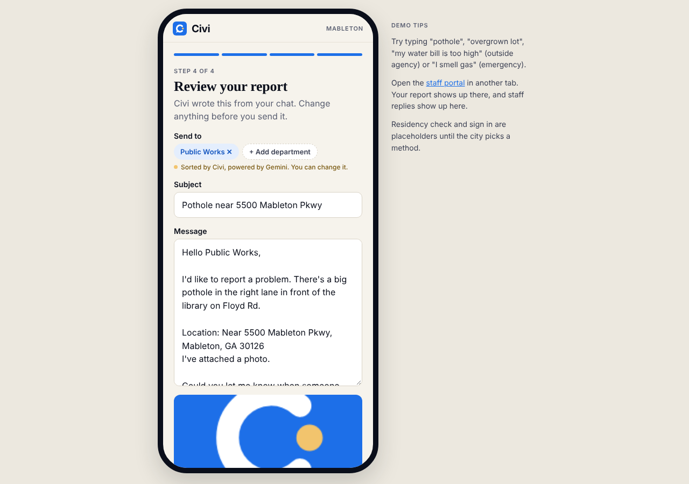
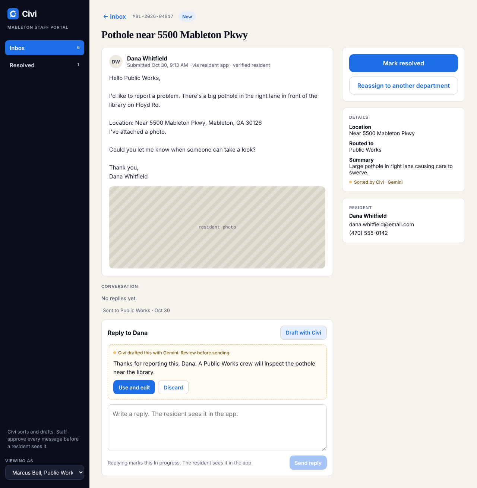

# Civi

**Civi is a CivIQ product.** CivIQ connects residents with their elected officials. Civi connects them with their city services.

This is the Civi pilot for the City of Mableton, Georgia. Built for the Georgia 311 Challenge, **Tiny Desk, Civic Style** track.

**Live demo:** _add your Vercel link here_

Mableton runs with a small staff of about 60 people. Every report that lands in the wrong inbox, or arrives missing a location, costs staff time. This app makes reports arrive already sorted and complete, and helps staff reply faster without taking people out of the loop.

| Resident app | Staff portal |
|---|---|
|  |  |

## Install it on your phone

Civi is an installable web app. No app store needed.

- **iPhone:** open the link in Safari, tap **Share**, then **Add to Home Screen**.
- **Android:** open the link in Chrome and tap **Install Civi** (or **Add to Home screen** in the menu).

It opens full screen with its own icon, goes straight to the resident app, and loads even without a signal. Reports and AI sorting still need a connection.

## How it works

**Residents (mobile app, `/#/resident`)**

1. Describe the problem in plain words in a chat.
2. Gemini sorts it to the right department (Public Works, Code Enforcement, Parks & Recreation, Planning & Zoning, or City Clerk).
3. Add a location (home address, a pin on a real map, or a typed address) and an optional photo. The map fills in the nearest street address, and "Use my location" jumps to where the phone is.
4. Review the complaint the app wrote for them, change anything, and send it. They can also tick **Share to the community feed** (off by default). Civi then suggests which reaction buttons neighbors should see, with a one sentence reason, and the resident can pick a different set.
5. Track status and reply to staff in the same thread.

**Community tab (resident app)**

- **City reports:** reports that residents chose to share and city staff approved. Each one shows only the issue title, a nearby street (never a house number), the department, the status and the date. Never a name, email, phone or home address.
- **Reactions:** each shared report has one reaction set, picked by the resident:
  - **I've seen this too** (one button). Shows staff how many people a problem affects.
  - **Still there / Looks fixed**. For problems that come back or drag on, like drains, flooding and streetlights.
  - **Why it matters**: two or three of "Unsafe", "Kids use this", "Blocks the sidewalk", "Hurts local businesses", "Slows traffic". For safety and access problems.
  - When staff mark a report resolved, a **Thank the crew** button appears on it. Each person can tap each button once, and tap again to undo.
- **Neighbor posts:** residents post to each other, like Nextdoor. Categories include missing person, lost pet, found pet, suspicious activity, crime and safety, lost and found items, roads and traffic, power and utilities, weather, events, recommendations, free and for sale, help and volunteering, and general, or **Other** with their own category name. Posts can have up to 5 tags, a street or area (house numbers are removed), and comments.
- **Reporting:** anyone can report a post or comment with a reason. City staff review every report and decide. A post reported by 3 different neighbors is hidden until staff look at it.
- **Safety prompts:** a missing person post reminds the resident to call 911 first. A suspicious activity post asks them to describe what the person did, not their race or appearance, and warns if the text mentions race. Any post that sounds like an emergency shows a Call 911 button before it can be posted.

If the issue belongs to another agency (Cobb County Water, Cobb schools, property taxes, GDOT), the app says so and links there instead of sending it. If the message sounds like an emergency ("I smell gas"), the app stops and shows a Call 911 button.

**Staff (desktop portal, `/#/staff`)**

- One inbox per department, with filters and search.
- Open a report, click **Draft with Gemini**, then edit and send the reply. The resident sees it in the app.
- Mark resolved, reopen, or reassign to another department.
- Each report shows its pin on a map, with an **Open in Google Maps** link for directions.
- **City map:** every pinned report across all departments, colored by status (new, in progress, resolved), with open counts per department.
- **Areas of concern:** staff post alerts for places crews should stay clear of, like a gas leak, an active fire, police activity, or an unsafe area. Each alert has a size and clears on its own after 2, 6 or 24 hours. Reports inside an alert area get a warning before anyone sends a crew. Alerts are for staff only and never shown to residents.
- **Share to community feed:** a toggle on each report, off by default. It only works if the resident asked to share, and staff can turn it off again at any time. Code Enforcement reports are about a specific property, so the toggle is disabled for them. The same card shows the reaction counts and how many neighbors thanked the crew.
- **Community:** a review queue of reported posts and comments. Staff keep them up (which clears the reports) or take them down with a reason the poster sees. Staff can take down any neighbor post, put it back up, and see every shared city report with its reaction counts.

## Responsible AI

- **A human approves every message.** Gemini only sorts reports, drafts replies, and suggests reaction buttons. Nothing reaches a resident until a staff member reviews it and clicks Send.
- **Reaction suggestions are only suggestions.** Gemini picks one of three fixed reaction sets and, for "Why it matters", only labels from a fixed list. The server and the app both check the answer and drop anything outside the list. The resident makes the final choice, and the screen says whether Civi (Gemini) or the keyword rules made the suggestion.
- **Nothing is shared without two yeses.** A report reaches the community feed only if the resident ticks the share box and a staff member turns on sharing. Names, emails, phones and house numbers are never shown, and Code Enforcement reports about private property are never shared.
- **People moderate, not AI.** Staff decide every report about a neighbor post or comment. AI never removes, hides or approves a post.
- **Emergencies never wait on AI.** Emergency words are checked on the phone itself before any AI call.
- **Always works.** If Gemini is not set up, slow, or over its free quota, the app falls back to keyword rules. Every screen shows whether Gemini or the keyword rules did the sorting.
- **The API key is never public.** It lives in a Vercel environment variable and is only used by the server functions in `/api`. It is not in the browser code or in this repo.
- **Public data only.** Department info and outside agencies come from public sources. Residents, addresses and complaints in the demo are made up.
- **Abuse limits.** Input length is capped, and each visitor is rate limited so the free quota can't be drained.
- **Maps share only the pin.** When a resident drops a pin, only its coordinates go to OpenStreetMap to look up the street address. Their location is only read when they tap "Use my location".
- **Alerts come from people.** Areas of concern are posted by staff, not guessed by AI, and Civi never collects emergency reports. A message that sounds like an emergency still goes straight to the Call 911 screen.

## Free to run

| Piece | Service | Cost |
|---|---|---|
| Hosting and server functions | Vercel Hobby | Free, no credit card |
| AI | Gemini API free tier (Google AI Studio key) | Free, no credit card |
| Maps | Leaflet with OpenStreetMap tiles and address lookup | Free, no key |
| Data | Stored in the browser for the demo | Free |

## Deploy your own copy

1. Get a free Gemini API key at [aistudio.google.com](https://aistudio.google.com).
2. Put this folder on GitHub (GitHub Desktop: **File > Add local repository**, then **Publish repository**, unchecking "Keep this code private").
3. Go to [vercel.com/new](https://vercel.com/new), import the repo, and keep the default settings (Vercel detects Vite).
4. Before clicking Deploy, open **Environment Variables** and add `GEMINI_API_KEY` with your key.
5. Click **Deploy**. Every push to `main` redeploys automatically.

## Run it locally

```bash
npm install
npm run dev          # app only, AI uses the keyword fallback
# or, with the AI routes:
npm i -g vercel
cp .env.example .env.local   # then paste your key
vercel dev
```

## Project layout

The two features live in their own folders. Anything both of them use sits in `shared/`.

```
api/                 Server functions (hold the Gemini key)
  triage.js          Sorts a report to a department, outside agency, or 911 (Resident)
  draft-reply.js     Drafts a staff reply for review (Staff)
  suggest-reactions.js  Suggests a reaction set for a shared report (Resident)
  _gemini.js         Shared Gemini call, input limits, rate limit
src/
  main.jsx           Entry point
  App.jsx            Home page and hash router (#/resident, #/staff)
  styles.css         Styles for both features
  resident/
    Resident.jsx     Feature 1: resident mobile app
  staff/
    Staff.jsx        Feature 2: staff desktop portal
    Moderation.jsx   Community review queue and shared reports
  community/
    Community.jsx    Community tab: city reports and neighbor posts
  shared/
    ai.js            Calls /api and falls back to keyword rules
    data.js          Departments, outside agencies, keyword rules, sample data
    store.js         Demo data kept in the browser, synced across tabs
    install.jsx      Install button for the installable app
    map.jsx          Pin picker, report maps, city map, staff alerts
    reactions.jsx    Reaction buttons and icons
public/              Favicon, app manifest, offline service worker, app icons
docs/                README screenshots
extras/              Files not used by the app (Java, prototype HTML, XML)
```

## Path to adoption

- **Pilot:** one department (Public Works) for 60 days, with staff using the portal next to their current inbox.
- **Before launch:** confirm the department list and outside agencies with the city, choose a residency check, and move storage from the browser to a city managed database.
- **Measure:** time to first reply, reports reassigned, and reports missing a location.

## Roadmap to the app stores

1. **Now:** installable web app (this repo).
2. **After the pilot:** wrap the same screens in Expo, the stack CivIQ already uses, for the App Store and Google Play.
3. **With the store release:** a city managed database, real sign in, and push notifications when staff reply.

## Prototype limits

- Sign in and address verification are placeholders until the city picks a method.
- Demo data is stored in each browser. Use **Reset demo data** on the home page to start fresh.
- Photos are simulated. Map pins are real.
- Alerts and the two sample alerts live in the browser like the rest of the demo data, so each device has its own copy.
- The OpenStreetMap tile and address services are fine for a pilot. A citywide launch should move to a hosted map provider or the city's own GIS.
